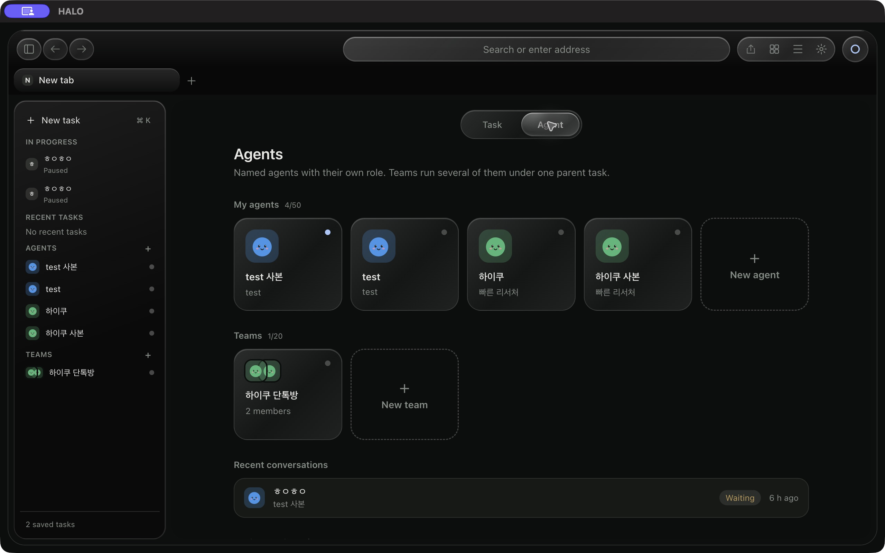

# HALO

HALO is a desktop browser for working with AI agents. It combines real Chromium
pages, task and team workspaces, and a host-controlled execution runtime. HALO Core
provides the project's safety research and approval/execution gateway.



## HALO Browser

The Electron app brings browser controls, agents and long-running tasks into one
workspace. Its React UI shows task status, approval requests and activity while
the host manages planner connections, browser surfaces and saved task state.

- **Browser workspace:** real web pages with navigation and tab controls, alongside
  task and agent panels.
- **Agents and teams:** agent configuration, team rooms and parent/child task
  coordination, with host-managed execution boundaries.
- **Long-running tasks:** saved goals, durable event journals, progress checks and
  recovery state. Pause, stop and takeover let the user intervene.
- **Execution review:** approval queues, policy checks and document epochs keep
  proposals tied to the state they were made against.
- **Local workflow:** routines, local memory and credential storage, with provider
  setup and optional routed MCP tool proposals.
- **Recovery on hard tasks (opt-in):** planner escalation steps up to a stronger
  model tier when one fails, and routing picks a tier by expected task length.
- **Effect-based approval:** actions are auto, ask or deny by effect; irreversible
  clicks (payments, account deletion) are refused outright in text-mode computer use.
- **Context Awareness (opt-in):** an encrypted local journal of pages you read that
  later tasks can recall. It skips sign-in, payment, mail and bank pages.

Current version: `0.1.0-beta`. The opt-in features are off by default.

### Run locally

From the repository root, with Node.js compatible with the pinned app packages
and Python 3.11+ for the local approver:

```sh
npm --prefix frontend ci
npm --prefix apps/computer-browser ci
npm --prefix apps/computer-browser start
```

Configure a planner using the [provider guide](apps/computer-browser/main/harness/providers/README.ko.md).
The [Browser README](apps/computer-browser/README.md) covers runtime builds,
source ownership and unit/Electron integration tests.

Browser permission modes are `observe`, `browse`, `interact` and `full`.
Routed MCP execution proposals require human approval regardless of that mode.
Task recovery records uncertain execution for review; an interrupted action is
not assumed safe to repeat.

## HALO Core

Core studies model-agnostic containment through synthetic experiments, Python/Rust
implementations and sandbox probes. Its gateway separates approver and executor
authority, requiring exact, short-lived capabilities and durable execution records.

The [Core README](halo/README.md) contains results, reproduction commands and research
limits. The [container guide](deploy/container/README.ko.md) covers its Docker gateway;
the browser uses a separate local approver. Compose does not containerize browser tasks.

See the [architecture guide](docs/ARCHITECTURE.ko.md) for shared boundaries. HALO is a
research prototype. Claims depend on stated threat models; no general containment
guarantee is claimed.
